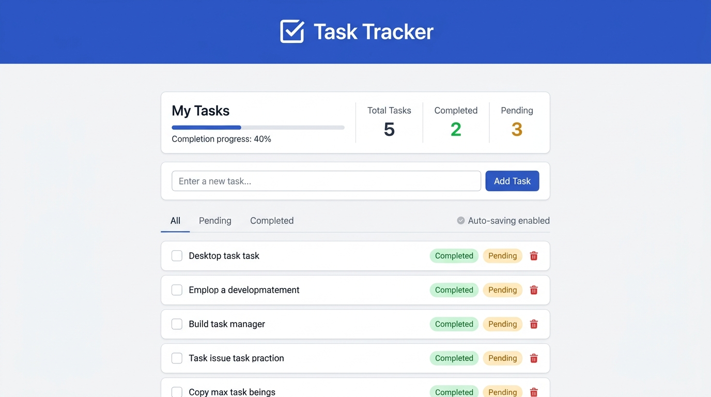
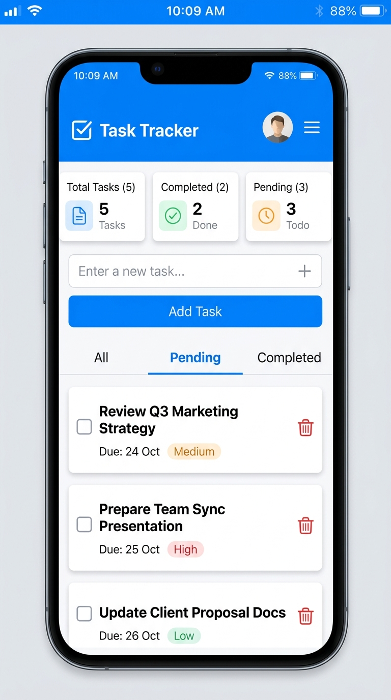

# Task Tracker — JTRONIX Frontend Internship Assessment

A high-performance, accessible, responsive Task Tracker web application built for the **JTRONIX Frontend Internship Assessment**. Designed with modern React architecture, Next.js App Router, Tailwind CSS, TypeScript, and robust client-side `localStorage` persistence.

---

## 🌟 Visual Preview

| Desktop View | Mobile View |
| :---: | :---: |


|  |  |

---

## 📋 Assessment Compliance Overview

The application satisfies all three sections of the JTRONIX assessment within a single unified codebase:

### Section 1.1: Create and Display Tasks
- **Input Field & Add Button**: Dedicated text input with responsive "Add Task" button.
- **Validation**: Strict rejection of empty strings and whitespace-only submissions with accessible error alerts.
- **Keyboard Submission**: Full support for pressing <kbd>Enter</kbd> to add tasks immediately.
- **Instant Clearing**: Input automatically clears and refocuses upon valid task submission.
- **Visual Display**: New tasks prepend to the top of the list for immediate visibility.

### Section 1.2: Manage Tasks
- **Task Status Toggling**: Interactive checkboxes allowing instantaneous toggling between `Completed` and `Pending` states.
- **Visual Distinction**:
  - **Completed Tasks**: Subtle strikethrough, muted text, checked box, and a green badge (`Completed`).
  - **Pending Tasks**: Dark readable typography, unchecked box, and an amber badge (`Pending`).
- **Task Deletion**: Red trash icon with accessible `aria-label` and an intuitive **Undo Toast** (allowing recovery within 5 seconds).
- **Real-time Statistics**:
  - **Total Tasks**: Total count of active items.
  - **Completed**: Live count of finished tasks with completion percentage badge.
  - **Pending**: Live count of remaining tasks.
  - **Progress Bar**: Animated completion progress bar updated in real time.

### Section 1.3: Filter and Save Tasks
- **Filtering System**: Segmented control tabs for `All`, `Pending`, and `Completed` with dynamic item count badges and an active view banner.
- **Browser Persistence**: Fully persistent in browser `localStorage` across page reloads and tab closures.
- **Zero Hydration Mismatch**: Uses React 19's `useSyncExternalStore` pattern to safely reconcile server-rendered markup with client storage.
- **Empty States**: Contextual empty states with custom graphics for when no tasks exist or when filter queries return zero results.
- **Responsive Layout**: Fluid layouts tested from mobile viewports (320px, 375px, 430px) through tablets (768px) and desktop monitors (1440px+).

---

## 🛠️ Technology Stack

- **Framework**: [Next.js](https://nextjs.org/) (App Router, Turbopack)
- **Library**: [React 19](https://react.dev/)
- **Language**: [TypeScript](https://www.typescriptlang.org/)
- **Styling**: [Tailwind CSS v4](https://tailwindcss.com/)
- **Icons**: [Lucide React](https://lucide.dev/)
- **Storage**: Browser `localStorage` via `useSyncExternalStore`
- **Testing**: Node.js Native Test Runner (`node:test`)

---

## 🚀 Getting Started

### Prerequisites

- **Node.js**: v18.18.0 or newer (v20+ / v24 recommended)
- **npm**: v9 or newer

### Installation

1. Clone or extract the repository:
   ```bash
   git clone <your-repo-url>
   cd "Frontend project"
   ```

2. Install dependencies:
   ```bash
   npm install
   ```

### Running Locally (Development Mode)

Start the local development server:
```bash
npm run dev
```

Open [http://localhost:3000](http://localhost:3000) in your browser.

### Building for Production

Compile and optimize the production bundle:
```bash
npm run build
```

Start the production server:
```bash
npm start
```

### Running Lint and Automated Tests

Check code quality with ESLint:
```bash
npm run lint
```

Run the automated test suite:
```bash
npm test
```

---

## 💾 LocalStorage Persistence Architecture

The persistence layer (`src/lib/task-storage.ts`) is engineered to solve common Next.js and React 19 challenges:

1. **Hydration Safety**:
   Traditional `useEffect` + `useState` can trigger React 19's `react-hooks/set-state-in-effect` rule or cause hydration mismatches between server HTML and client browser storage.
   We implemented `useSyncExternalStore`:
   - `getServerSnapshot()` returns an empty state during SSR.
   - `getTasksSnapshot()` returns memoized tasks parsed from `localStorage` on the client.
   - `subscribeToTasks()` subscribes to both app-level mutations and cross-window `storage` events.

2. **Data Validation & Recovery**:
   When reading from `localStorage`, each item is verified for correct type structure (`id`, `title`, `completed`). Malformed records are filtered out gracefully without crashing.

3. **Sample Initializer**:
   On the very first visit, default tasks matching the assessment specification are seeded automatically so the reviewer immediately experiences a populated interface.

---

## 🧪 Verification & Testing Checklist

| Test Scenario | Status | Result |
| :--- | :---: | :--- |
| **Empty Input Validation** | ✅ PASS | Blank & whitespace-only inputs trigger validation warning |
| **Enter Key Submission** | ✅ PASS | Pressing Enter adds task and resets the input field |
| **Task Prepending** | ✅ PASS | Newly added tasks appear at the top of the list |
| **Toggle Status** | ✅ PASS | Checkbox toggles status, strikethrough, and badge instantly |
| **Live Stats Counter** | ✅ PASS | Total, Completed, Pending, and % bar update immediately |
| **Filter Switching** | ✅ PASS | All, Pending, and Completed filters correctly slice tasks |
| **Task Deletion** | ✅ PASS | Selected task is removed with an available Undo option |
| **Browser Refresh Persistence**| ✅ PASS | Tasks and statuses survive full browser reload |
| **Zero Hydration Errors** | ✅ PASS | Clean SSR-to-client hydration with `useSyncExternalStore` |
| **Lint & Typecheck** | ✅ PASS | `npm run lint` and `npm run build` pass with 0 errors |
| **Unit Test Suite** | ✅ PASS | 10/10 automated tests pass via `node:test` |

---

## 📦 Submission & GitHub Instructions

### 1. Uploading to GitHub

```bash
# Initialize git if not already present
git init

# Add all project files (.gitignore excludes node_modules and .next)
git add .

# Create initial commit
git commit -m "feat: complete JTRONIX Task Tracker assessment application"

# Link to your GitHub repository and push
git branch -M main
git remote add origin https://github.com/<your-username>/<your-repo-name>.git
git push -u origin main
```

### 2. Creating a Source Code ZIP

To create a clean ZIP archive for direct submission (excluding `node_modules` and `.next`):

**PowerShell (Windows)**:
```powershell
Compress-Archive -Path src, public, tests, package.json, package-lock.json, tsconfig.json, next.config.ts, eslint.config.mjs, README.md, .gitignore -DestinationPath jtronix-task-tracker-submission.zip -Force
```

### 3. Deploying to Vercel (Optional)

1. Push your repository to GitHub.
2. Visit [Vercel](https://vercel.com/) and click **Add New Project**.
3. Import your GitHub repository.
4. Leave build settings as default (Framework: Next.js).
5. Click **Deploy**. Vercel will build and assign a live production URL.

---

## 👤 Author

Developed for the **JTRONIX Frontend Internship Assessment**.
Built with precision, accessibility, and modern React practices.
